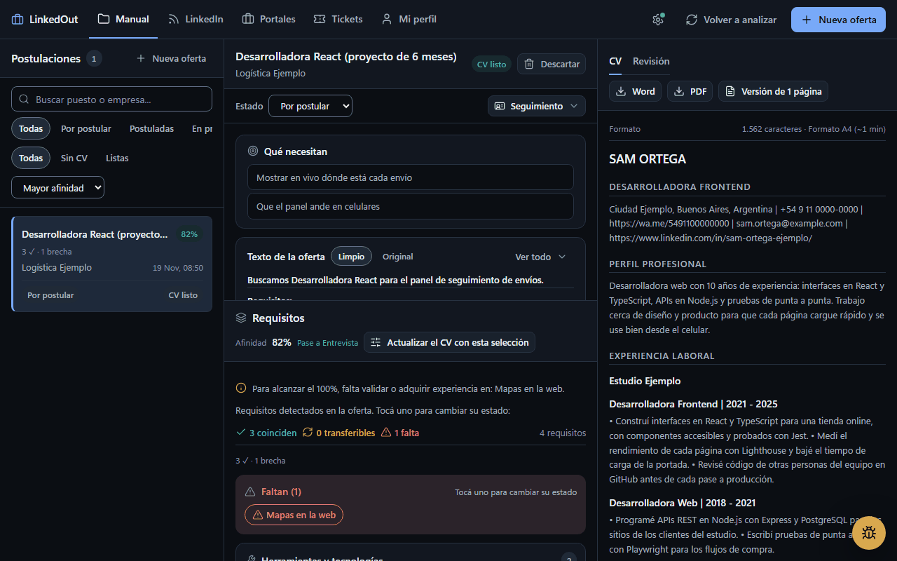
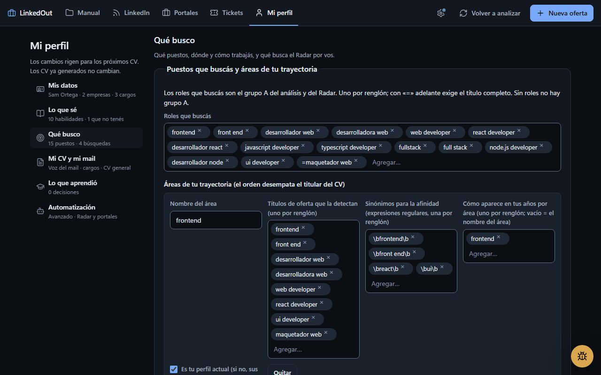
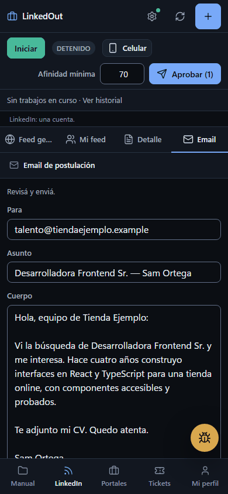

# LinkedOut

**Tu asistente para buscar trabajo, en tu propia PC.** LinkedOut encuentra ofertas, te dice cuánto encajan con tu
experiencia y te prepara un CV y un mail a medida para cada una. Vos revisás y decidís qué se envía.

## Para quién es

Para quien busca trabajo y quiere postularse a más ofertas sin escribir cada CV de cero, sin perder el control de lo
que manda. Funciona en Windows y se usa también desde el celular. Tus datos quedan en tu PC: no hay cuentas ni
servidores de terceros.

## Cómo funciona

1. **Encuentra ofertas.** Lee los posts de LinkedIn de tus búsquedas y los avisos de portales de empleo (Jooble,
   Indeed y otros), o cargás una oferta a mano pegando el texto o el link.
2. **Las analiza.** Compara cada requisito con tu experiencia (lo que cumplís, lo que es transferible y lo que te
   falta) y calcula la afinidad. Si no estás de acuerdo con algo, lo cambiás con un toque y lo recuerda.
3. **Prepara la postulación.** Arma un CV adaptado a esa oferta y el mail para quien publicó. Los revisás, los
   ajustás y aprobás el envío; si la oferta pide postularse por un link o por WhatsApp, te deja el mensaje listo.

## Cómo se ve

| En la computadora | En el celular |
|---|---|
|  |  |
|  |  |

Más capturas, también en tablet, en [docs/capturas](docs/capturas/).

Todo lo que ves (la persona, las empresas y las ofertas) es inventado.

## Un CV de ejemplo

[CV de ejemplo en PDF](docs/ejemplo/CV_Sam_Ortega_ejemplo.pdf), armado por LinkedOut para una persona inventada.

## La app

LinkedOut se abre en el navegador o como una app de la PC: en Edge, tocá **Instalar app** y queda con su ícono en
Inicio y en la barra de tareas. En el celular entrás escaneando el código QR que muestra el botón **Celular**.
Detalles en [docs/app-escritorio/plan.md](docs/app-escritorio/plan.md).

## Instalación

Necesitás Windows con Microsoft Edge, [Python 3.14](https://www.python.org/downloads/) y Antigravity (el programa
de IA que usa LinkedOut) con tu sesión iniciada.

1. Instalá lo que usa LinkedOut: `python -m pip install -r requirements.txt`
2. Copiá el perfil de ejemplo a la carpeta de datos y cambialo por los tuyos (también se edita desde **Mi perfil**):
   `Copy-Item -Recurse config\ejemplo\candidato dev-datos\candidato`. Para guardar los datos en otra carpeta,
   indicala en la variable `LINKEDOUT_DATA_DIR`.
3. Para enviar mails, creá el archivo `dev.env` con `GMAIL_ADDRESS` y `GMAIL_APP_PASSWORD` (una contraseña de
   aplicación de Google).
4. Abrí LinkedOut: `python -m uvicorn server:app --port 1111` y entrá a <http://localhost:1111>.
5. En **LinkedIn**, tocá **Iniciar** e iniciá sesión en la ventana de Edge que se abre (una sola vez).

La guía completa, con cada parte del portal y los errores comunes, está en [docs/uso.md](docs/uso.md).

## Más información

- [Guía de uso](docs/uso.md): vistas, estados de una oferta, envíos y configuración.
- [Tu perfil](docs/perfil.md): qué guarda cada archivo y cómo se edita.
- [El Radar de LinkedIn](docs/radar.md) y [los portales de empleo](docs/portales.md).
- [Errores y tickets](docs/tickets.md), [despliegue](docs/despliegue.md) y [seguridad](docs/seguridad/plan.md).
- [Código y pruebas](docs/codigo-y-tests.md).

## Aviso

Leer LinkedIn de forma automática va contra sus condiciones de uso y puede traer restricciones en tu cuenta.
LinkedOut lee con ritmo humano y se detiene ante cualquier verificación, pero el riesgo existe: usalo bajo tu
responsabilidad. El inicio de sesión y las verificaciones de seguridad nunca se automatizan.

## Licencia

[MIT](LICENSE).
