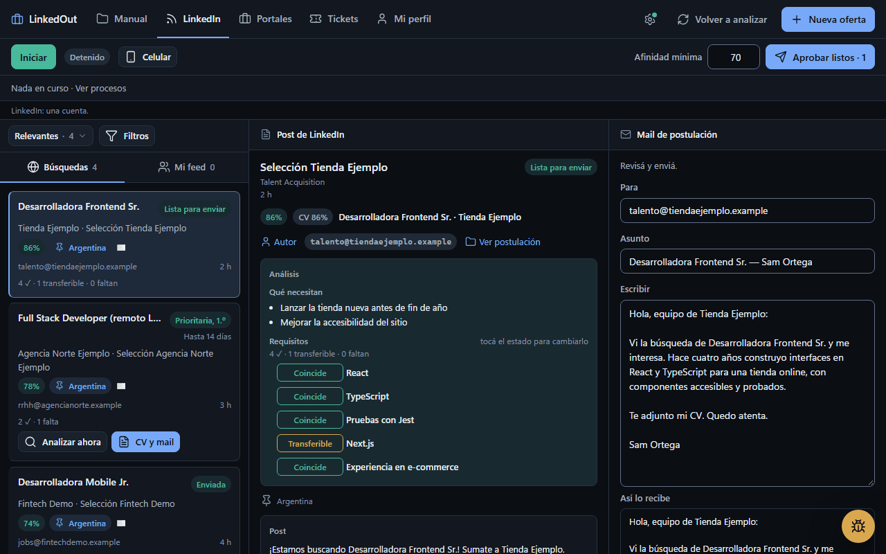
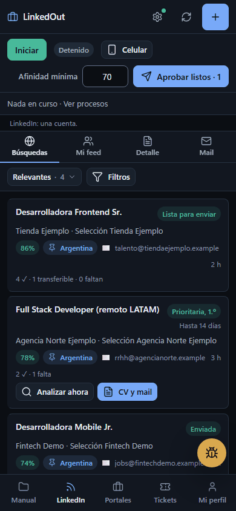

# LinkedOut

Asistente para buscar trabajo, en tu PC. Encuentra ofertas, las compara con tu experiencia y te prepara un CV y un mail
para cada una. Vos revisás y decidís qué se envía.

## Cómo

1. **Busca:** lee LinkedIn y portales de empleo con tus búsquedas.
2. **Analiza:** marca qué requisitos cumplís, cuáles son transferibles y cuáles faltan.
3. **Prepara:** arma el CV y el mail a medida con IA.

Instalación y uso: [docs/uso.md](docs/uso.md) · Licencia [MIT](LICENSE)
